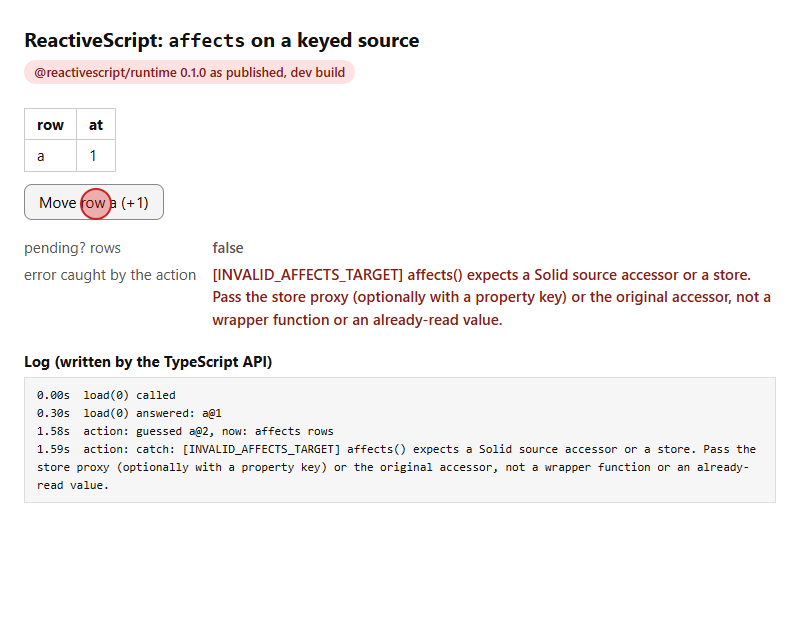
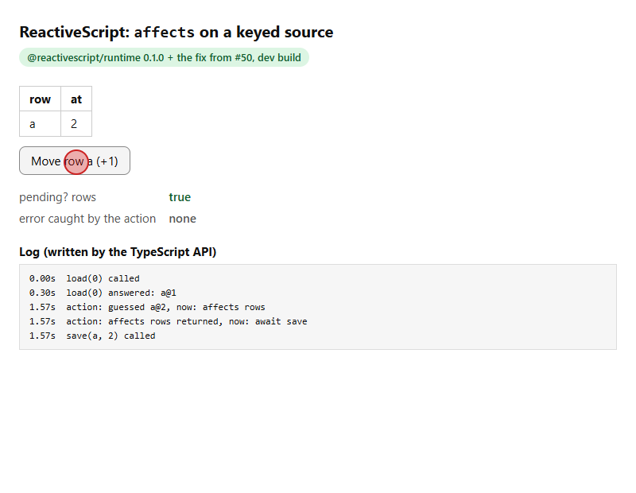
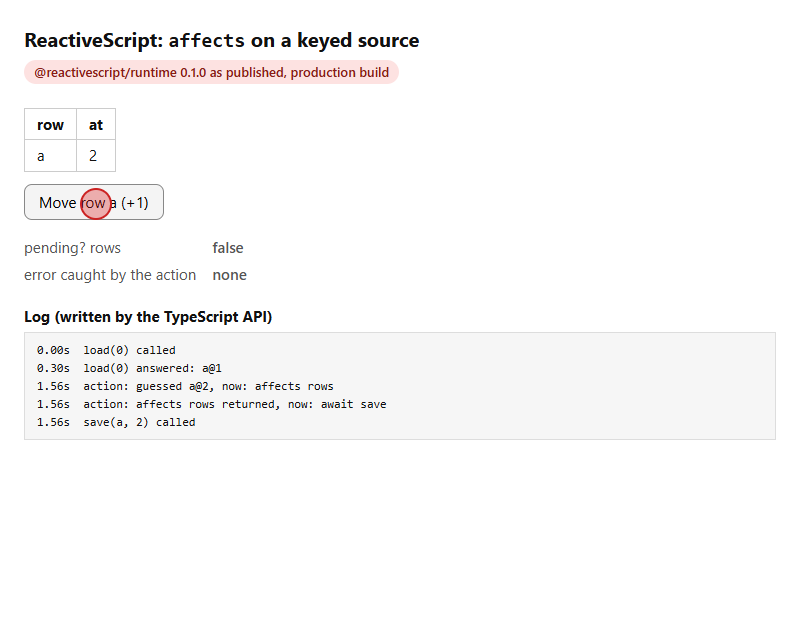
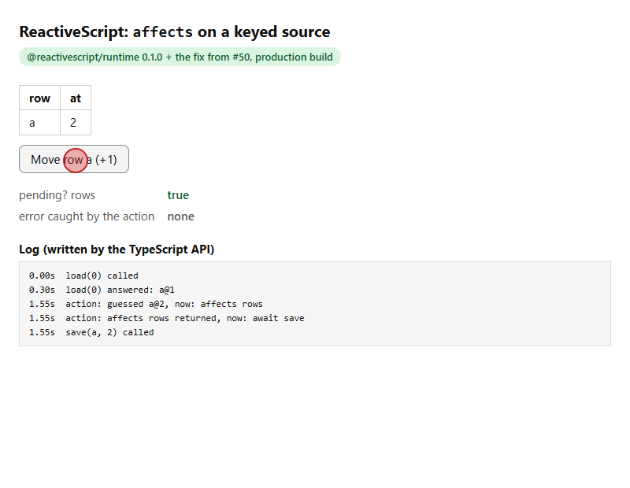

# Repro: `affects` on a keyed source (solidjs/reactivescript#50)

`affects xs`, where `xs` is a keyed source (`source xs key id = …`), passes Solid's `affects()` the
runtime's accessor wrapper `() => store` instead of the store. Solid refuses a wrapper function:

- **dev build:** `affects()` throws `INVALID_AFFECTS_TARGET`. The action's `catch` gets it, the
  `await save(…)` after it never runs, and the guess reverts.
- **production build:** `affects()` returns without doing anything. The save runs, but
  `pending? xs` is never `true`.

The fix is the unwrap `refresh` already does one line above in the runtime
(`node_modules/@reactivescript/runtime/dist/web.js`, `ref/compile/rt-web.ts` in the repo):

```diff
-    affects: (get) => affects(get),
+    affects: (get) => affects(storeAccs.has(get) ? get() : get),
```

## The program

[`src/App.rx`](src/App.rx): one keyed row over a fake server answer. Clicking the button guesses
`a + 1`, declares `affects rows`, saves (1.5 s), and re-asks the day.

```rx
action move() {
  try {
    let i = rows.findIndex(r => r.id == "a")
    let next = rows[i].at + 1
    optimistic rows[i].at := next
    affects rows
    await save("a", next)
    refresh day
  } catch (e) {
    err := e.message
  }
}
```

Expected (spec 06 AC-5): the guess shows, `pending? rows` is `true` until the save is done, and
`save` is called.

## Result

Measured in Chrome 157 by [`record.mjs`](record.mjs). The raw numbers are in
[`media/results.json`](media/results.json).

| variant | 300 ms after the click | `save()` called | settled |
| --- | --- | --- | --- |
| dev, runtime as published | `at` 1, `pending? rows` false, **`INVALID_AFFECTS_TARGET` thrown** | **no** | `at` 1 (guess reverted) |
| dev, runtime + fix | `at` 2, `pending? rows` **true** | yes | `at` 2, `pending? rows` false |
| production, runtime as published | `at` 2, `pending? rows` **false** | yes | `at` 2 |
| production, runtime + fix | `at` 2, `pending? rows` **true** | yes | `at` 2, `pending? rows` false |

### Dev build

| runtime as published | runtime + fix |
| --- | --- |
|  |  |
|  |  |

### Production build

| runtime as published | runtime + fix |
| --- | --- |
|  |  |
|  |  |

Videos: [dev, as published](media/dev-bug.mp4) · [dev, fixed](media/dev-fixed.mp4) ·
[production, as published](media/prod-bug.mp4) · [production, fixed](media/prod-fixed.mp4).
All screenshots, before, 300 ms after the click and settled, are in [`media/`](media).

## Run it

```sh
pnpm install
pnpm dev          # http://localhost:5173, the runtime as published
pnpm dev:fixed    # http://localhost:5174, the same runtime file with the one-line fix
pnpm record       # re-records media/ (needs Google Chrome; ffmpeg for the .mp4/.gif)
```

`--mode fixed` applies the fix with a small Vite plugin ([`vite.config.mjs`](vite.config.mjs)) that
replaces that one line in the published `dist/web.js`. It fails if the line isn't there, so nothing
else differs between the two variants. The page header says which runtime is running.

Versions: `@reactivescript/compiler` and `@reactivescript/runtime` 0.1.0, `solid-js`,
`@solidjs/web` and `@solidjs/signals` 2.0.0-rc.21, `@solidjs/vite-plugin` 3.0.0-next.57, Vite 8.1.3.

---

Built with Opus 5.5 while migrating a web app to ReactiveScript.
